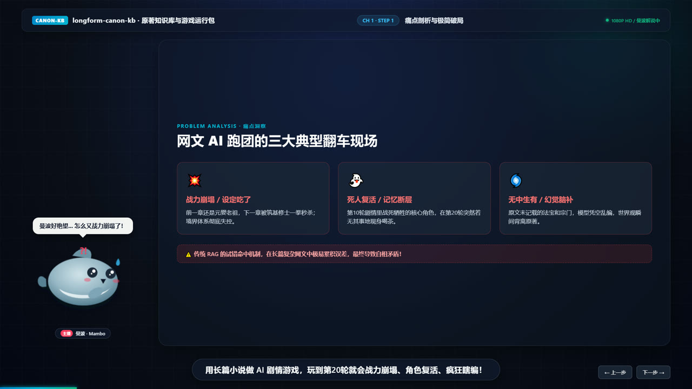

# web-video-presentation

把文章 / 口播稿做成**网页视频**：用 React 逐帧渲染幻灯片，由 Playwright 驱动播放，FFmpeg 合成成片与字幕。可选纯网页播放（手动翻页），也可一键跑成 MP4。



## 它解决什么

传统做法是「做 PPT → 录屏 → 剪辑」，改一句话就要重录整段。这个项目把「画面」和「时间轴」解耦：

| 层 | 文件 | 职责 |
|---|---|---|
| 画面 | `src/App.tsx` + `src/styles.css` | 每个 `visualHint` 对应一版幻灯片，1920×1080 固定舞台 |
| 台词 | `src/narration.ts` | 章节 / 步骤 / 旁白 / 视觉提示，唯一内容源 |
| 时间轴 | `public/timeline/timeline.json` | TTS 音频实测时长换算出的 `start / end / duration`（生成物，不入库） |
| 成片 | `scripts/render/*` | 起服务 → 逐帧截图 → 合成音视频 → 烧字幕 → QA 报告 |

改一句台词只需要重跑对应那一步，不用重录全片。

## 环境要求

- Node 18+
- FFmpeg + ffprobe（需在 `PATH` 里）
- Playwright Chromium（`npx playwright install chromium`）
- 生成音频还需要 Python 3 + `edge-tts`（`pip install edge-tts`）

一条命令自检：

```bash
npm run render:check
```

会逐项检查 Node / npm / FFmpeg / ffprobe / Playwright / Chromium / 字体，缺什么直接报出来。

## 快速开始

```bash
npm install
npm run dev
```

- `http://localhost:5173` —— 手动翻页，用来调画面
- `http://localhost:5173/?auto=1` —— 按时间轴自动播放，用来核对节奏

手动模式不依赖时间轴，直接用 `src/narration.ts` 里的 `DEFAULT_NARRATIONS` 生成等长的兜底时间轴（每步 4.5s），所以改完画面立刻能看。

## 出片

```bash
# 1. 台词 → TTS 音频（edge-tts，产物在 out/audio/）
python scripts/render/generate-audio.py

# 2. 音频 → 时间轴
npm run render:audio

# 3. 字幕
npm run render:subtitles

# 4. 逐帧渲染 + 合成
npm run render
```

产物：

```text
out/final/video.mp4            成片
out/subtitles/subtitles.ass    ASS 字幕（烧进画面）
out/subtitles/subtitles.srt    SRT 字幕（外挂）
out/timeline/timeline.json     实际使用的时间轴
out/qa/render-report.md        帧数 / 时长 / 丢帧 / 编码参数核对
```

### 局部重跑

```bash
npm run render:audio       # 只重算时间轴
npm run render:subtitles   # 只重生成字幕
npm run render:preview     # 只渲一小段试片
npm run render:full        # 全量重跑
```

## 渲染桥

自动播放时，页面通过 `window.__WEB_VIDEO_RENDER__` 把控制权交给外部驱动器，避免「定时器 vs 逐帧截图」的时钟漂移：

```ts
window.__WEB_VIDEO_READY__                       // 页面就绪，可以开始截图
window.__WEB_VIDEO_RENDER__.goto(chapter, step)   // 精确跳到某一步
window.__WEB_VIDEO_RENDER__.done                 // 全片播完
```

带 `?driver=renderer` 打开时页面内不起定时器，完全由 Playwright 推进一步、截一帧，保证帧与帧之间状态确定。

## 目录

```text
src/
  App.tsx           舞台、导航、进度条、渲染桥
  narration.ts      台词与视觉提示（唯一内容源）
  MamboAvatar.tsx   解说员形象（SVG，纯组件，已 memo）
  styles.css        全套样式与动效
scripts/render/
  check-env.mjs          环境自检
  generate-timeline.mjs  音频时长 → 时间轴
  generate-subtitles.mjs 台词 → ASS/SRT
  generate-audio.py      edge-tts 批量配音
  render-video.mjs       主流程
  lib/                   ffmpeg / playwright / 字幕 / 时间轴封装
public/
  architecture.svg  架构图（三张架构幻灯片共用）
templates/           新项目脚手架
```

## 已知约束

- **固定 1920×1080 舞台**：`<meta viewport width=1920>` 是刻意的，页面按视频规格排版，不适合当普通响应式网页浏览。
- **字体必须预装**：成片用的是本机字体，换机器渲染会出现字宽与换行差异。`render:check` 会提示缺失字体。
- **`public/timeline/*.json` 是生成物**：由 `render:audio` 产出，已在 `.gitignore` 中排除，不要手改。
- **架构图偏密**：`public/architecture.svg` 是 1600×1064 的六层全景图，塞进半栏后小字在 1080p 下偏难读；后续按 L0–L5 拆成三张分图会更清楚。

## License

MIT
